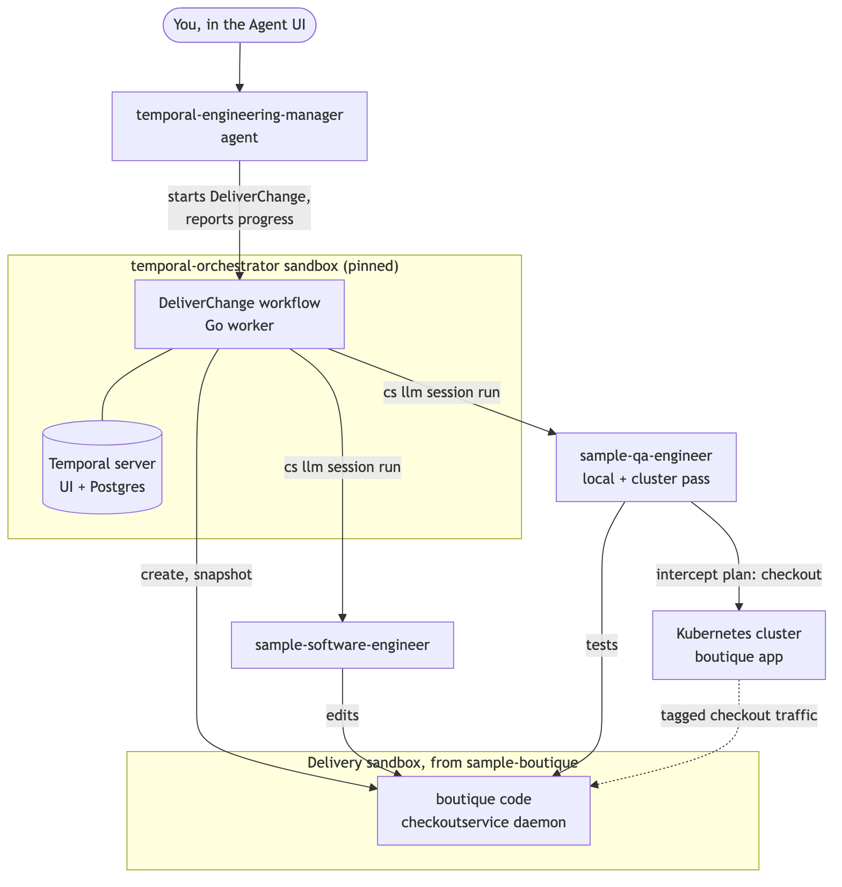
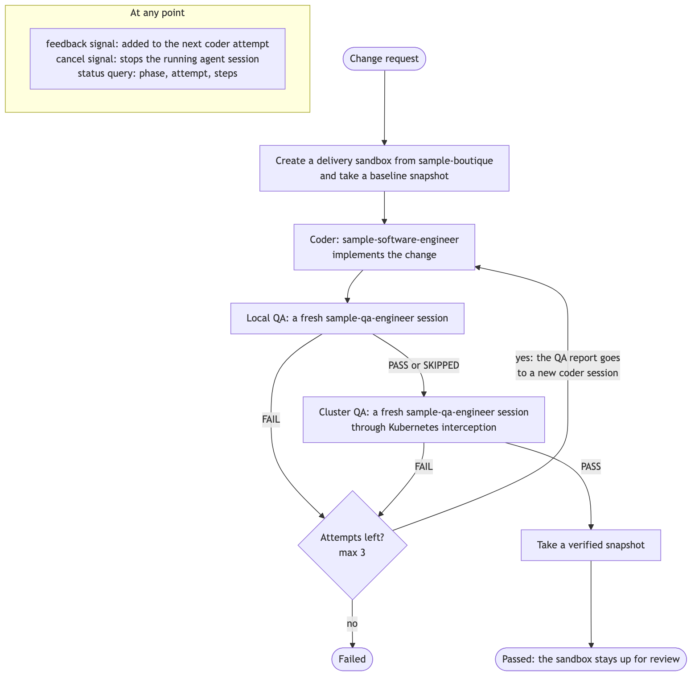

# Multi-agent delivery with Temporal on Crafting

An engineering-manager agent that delivers a code change through a durable
[Temporal](https://temporal.io) workflow. A coder agent implements the change, fresh QA
agents verify it locally and on a Kubernetes cluster, and failures go back to the coder
with QA's evidence. Every step is recorded in Temporal history.

## Try it for yourself

**1. Install [Crafting Express](https://github.com/crafting-dev/express).**

```bash
curl -sSL https://sandboxes.cloud/sh/install-cli | bash
cs express start
```

**2. Configure your LLM.** In the Express web console, open **Connect → LLM**, add a
provider, and assign a model to the `GENERIC` purpose
([guide](https://docs.sandboxes.cloud/guides/admin/manage-llm.html)).

**3. Install.** In the Agent UI, start a new session with the **default agent** and paste:

```text
Install the Temporal Engineering Manager from https://github.com/crafting-demo/multiagent-temporal and follow INSTALL.md.
```

**4. Try it.** Start a new session, select **temporal-engineering-manager**, and paste:

```text
In the boutique shop's checkoutservice, make order confirmation numbers human-readable: `BTQ-`, then today's date as YYYYMMDD, then 6 random uppercase letters or digits, for example `BTQ-20261015-7KQ2ZD`. Verify on the cluster by placing an order and reading the confirmation number from the confirmation page.
```

The agent replies with a Temporal UI link. Over the next 5 to 10 minutes, a new `tsp-…`
sandbox appears, followed by the coder session and each QA session in the Agent UI.

To see the result, open the new sandbox's `dev` endpoint and place an order: the
confirmation number reads `BTQ-…`. Through the `shop` endpoint you still get the old
UUID, because only traffic tagged for the sandbox reaches its `checkoutservice`.

## How it works

<details>
<summary>Architecture</summary>



The agent only starts and reports on the workflow. The worker in `temporal-orchestrator` runs each
agent session as a Temporal activity, using `cs llm session run`.

</details>

<details>
<summary>The DeliverChange workflow</summary>



Each agent session has heartbeats, a timeout, and retries, and a retried step rejoins its
session instead of starting a second agent. If the worker restarts, the workflow resumes
where it left off.

</details>

## Repository layout

| Path | Contents |
| :-- | :-- |
| `INSTALL.md`, `install.sh` | Install steps the default agent follows, and the script it runs |
| `agents/temporal-engineering-manager.yaml` | The agent you talk to |
| `templates/temporal-orchestrator.yaml` | The orchestrator sandbox: Temporal server, UI, Postgres, and a workspace that checks out this repo and runs the worker |
| `orchestrator/` | The Go workflow, activities, prompts, worker, and CLI; `AGENT.md` is the agent's runbook |
| `docs/` | Diagrams and the [reference](docs/reference.md): CLI, options, signals, and development |

Requires the sample agents, the `sample-boutique` template, and the demo cluster that
`cs express start` sets up by default.

## License

Apache License 2.0. See [LICENSE](LICENSE).
